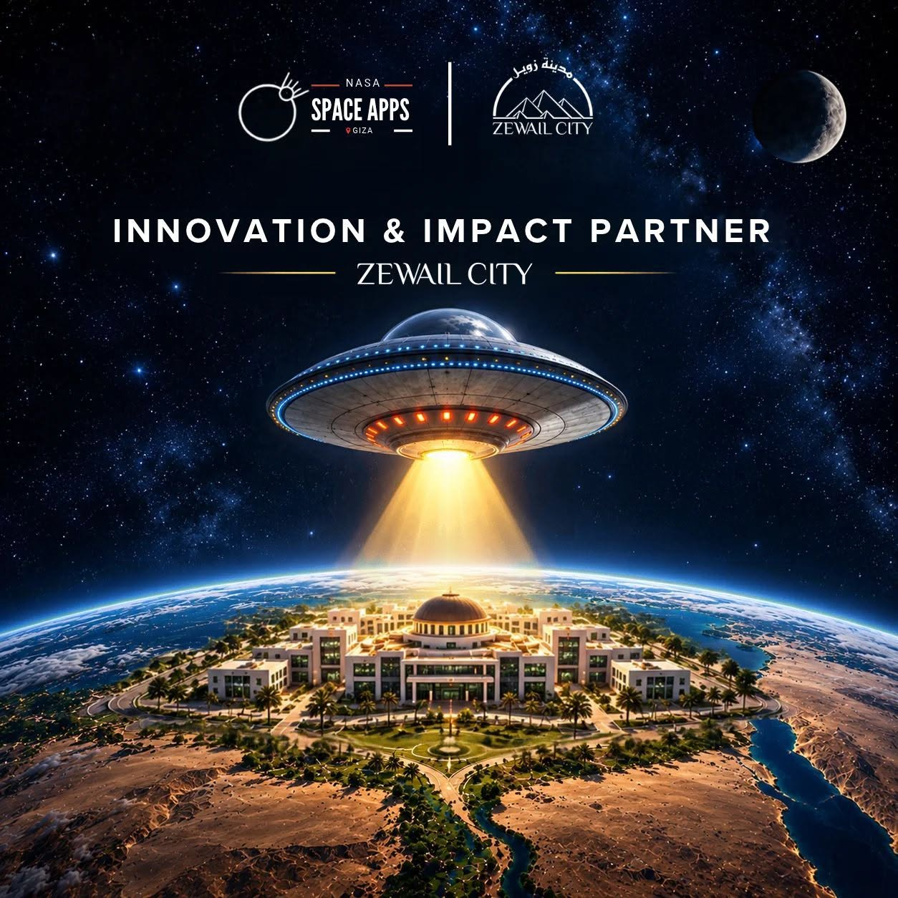
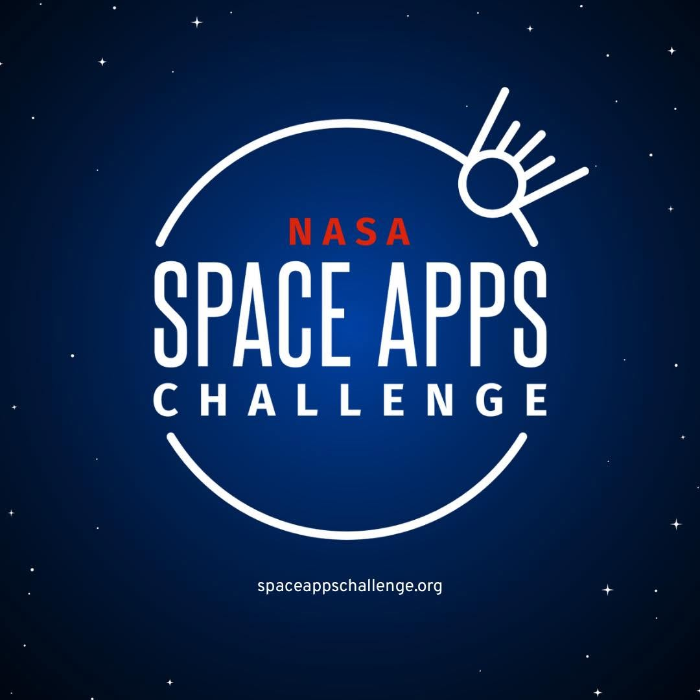

 

# 🌍 FIELD SHIFT
### Adapting Farms with NASA Data

**Exploring a More Resilient Future for Agriculture Through Earth Observation.**

 

  

 

 

**Six Team Members · One Global Challenge · One Shared Mission**

---

## 🚀 About Our Participation

We are excited to announce that our team has been accepted into the **2026 NASA Space Apps Challenge**, one of the world's largest annual hackathons focused on science, technology, creativity, and innovation.

For this year's challenge, we have selected:

# 🌱 Field Shift: Adapting Farms with NASA Data

Our participation will take place at the **Zewail City Local Event, Giza, Egypt**, on November 13–14, 2026.

This repository currently documents our participation, selected challenge, and the scientific problem we will be exploring during the hackathon.

**We are currently in the pre-hackathon stage. Project development and implementation will begin during the official event.**

---

## 🌍 The Challenge

### Field Shift: Adapting Farms with NASA Data

Agriculture is facing increasingly complex environmental challenges.

Rising temperatures, unpredictable rainfall, water shortages, and declining soil health are making agricultural planning more difficult.

Farmers must decide which crops to grow, when to plant them, and how to manage their land while protecting soil quality and conserving valuable water resources.

NASA Earth observation data offers an opportunity to better understand these environmental changes.

The challenge invites participants to explore how satellite observations, local soil information, crop characteristics, and farmer priorities can support smarter crop rotation decisions.

---

## 🎯 Challenge Objectives

The challenge focuses on exploring how technology and Earth science can support climate-resilient agriculture.

Key objectives include:

- Understanding environmental changes affecting agricultural fields.
- Exploring historical rainfall and temperature patterns.
- Investigating soil moisture and vegetation conditions.
- Examining potential agricultural vulnerabilities.
- Exploring alternative crop rotation strategies.
- Comparing environmental trade-offs between different agricultural choices.
- Making scientific information understandable and useful for farmers.

---

## 🛰️ NASA Earth Observation Resources

The challenge identifies several NASA datasets that participants may explore.

These are potential data sources, not datasets already integrated into a project.

| Dataset | Description | Potential Relevance |
|---|---|---|
| SMAP | Soil moisture observations | Soil water conditions |
| ECOSTRESS | Land surface temperature and evapotranspiration | Heat and water stress |
| GPM | Global precipitation measurements | Rainfall variability |
| Landsat | Multispectral Earth observations | Vegetation and land monitoring |
| MODIS | Land and vegetation observations | Seasonal environmental changes |
| NASA POWER | Meteorological and solar data | Historical climate conditions |
| GRACE / GRACE-FO | Terrestrial water storage changes | Regional water availability |
| SRTM | Digital elevation data | Terrain and erosion analysis |

### Official NASA Resources

- [NASA Earthdata](https://www.earthdata.nasa.gov/)
- [NASA POWER](https://power.larc.nasa.gov/)
- [SMAP Mission](https://smap.jpl.nasa.gov/)
- [ECOSTRESS](https://ecostress.jpl.nasa.gov/)
- [Global Precipitation Measurement](https://gpm.nasa.gov/)
- [Landsat Missions](https://landsat.gsfc.nasa.gov/)
- [MODIS](https://modis.gsfc.nasa.gov/)
- [GRACE Mission](https://grace.jpl.nasa.gov/)
- [NASA SRTM](https://www2.jpl.nasa.gov/srtm/)

---

## 🌾 Understanding the Agricultural Problem

The challenge highlights several important agricultural considerations:

| Environmental Factor | Why It Matters |
|---|---|
| Temperature | Heat can affect crop growth and productivity. |
| Rainfall | Changing precipitation affects planting and irrigation decisions. |
| Soil Moisture | Water availability influences crop development. |
| Vegetation Health | Remote sensing can help monitor vegetation conditions. |
| Soil Fertility | Nutrient depletion can affect long-term productivity. |
| Water Availability | Water limitations influence sustainable crop choices. |
| Erosion | Soil loss can threaten long-term agricultural sustainability. |

### Crop Rotation Considerations

The challenge also encourages exploring agricultural strategies involving:

- Nitrogen-fixing crops.
- Cover crops.
- Deep-rooting crops.
- Drought-tolerant crops.
- Crops that contribute to improved soil structure.
- Crop sequences that may help interrupt pest cycles.

---

## 🏆 Event Information

### NASA Space Apps Challenge 2026

**FIELD SHIFT: Adapting Farms with NASA Data**

| Event Detail | Information |
|---|---|
| Competition | NASA Space Apps Challenge 2026 |
| Participation Status | Accepted |
| Selected Challenge | Field Shift |
| Local Event | Zewail City |
| Location | Giza, Egypt |
| Event Dates | November 13–14, 2026 |
| Team Size | 6 Members |
| Current Stage | Pre-Hackathon |

---

## 👥 Meet Our Team

### Six Members. One Shared Vision.

We are a team of six participants joining the NASA Space Apps Challenge 2026 at Zewail City.

| # | Team Member | GitHub |
|---|---|---|
| 01 | Abdullah Mahmoud — Team Lead | [@AbdalluhMahmoud](https://github.com/AbdalluhMahmoud) |
| 02 | Ahmed Mahmoud | [@AboAsal](https://github.com/AboAsal)                          |
| 03 | Osama Mahmoud | [@OsamaMahmoud](https://github.com/Osamabably87)                     |
| 04 | David Fam     | [GitHub Profile](https://github.com/)                                 |
| 05 | Ahmed Hassan  | [GitHub Profile](https://github.com/)                                 |
| 06 | Georgios Marqus| [GitHub Profile](https://github.com/)                                |

*Team member details and individual contributions will be updated as appropriate.*

---

## 📅 Our Hackathon Journey

| Stage | Status |
|---|---|
| NASA Space Apps Acceptance | Completed |
| Challenge Selection | Completed |
| Pre-Hackathon Preparation | Current Stage |
| Official Hackathon | November 13–14, 2026 |
| Project Development | During the Official Event |
| Project Documentation | To Be Updated |

---

## 🔬 Project Development

This repository will evolve during the official hackathon.

Following the beginning of the event, this section will be updated with verified information about our actual work, including:

- Project concept and proposed solution.
- System architecture.
- NASA datasets actually selected and used.
- Data processing and analytical methods.
- Implemented technologies.
- Application screenshots and demonstrations.
- Team contributions.
- Results, limitations, and future improvements.

We believe that transparency and scientific accuracy are essential parts of responsible innovation.

---

## 🌱 Our Perspective

We believe that understanding our planet is an important step toward protecting its future.

Earth observation data gives us a new perspective on environmental change, while technology creates opportunities to make scientific knowledge more accessible.

Through the NASA Space Apps Challenge, we are excited to explore how science, engineering, and collaboration can contribute to a more sustainable agricultural future.

---

## 🙏 Acknowledgments

We would like to thank:

- **NASA Space Apps Challenge** for creating a global platform for innovation and scientific exploration.
- **NASA Earth Science** for making valuable Earth observation resources publicly accessible.
- **Zewail City of Science and Technology** for hosting the Giza local event.

---

# 🌍 FIELD SHIFT

### Understanding Earth. Exploring Possibilities. Shaping Tomorrow.

**NASA Space Apps Challenge 2026**

**Zewail City Local Event · Giza, Egypt**

*November 13–14, 2026*

